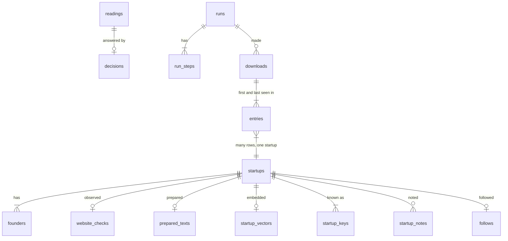

# Data

One SQLite file (`data/athar.db`) holds everything. Five kinds of table, kept apart:

- **As published**: what the registry said, never edited.
- **Derived by rule**: rebuilt from the published rows at any time; nobody edits them by hand.
- **Readings**: every derived value or link worth explaining, with the lane it landed in, the rule that produced it and the reason. Rebuilt on every Build, Check websites and Embed.
- **Kept by the owner**: answers to the questions the rules could not settle (`decisions`), notes with a source (`startup_notes`) and followed startups (`follows`). No step rebuilds or deletes them.
- **Observed or computed by Athar**: website answers, prepared text, vectors, idea checks.

The published value is always kept. A derived value (a display name, a founder's spelling, a website state) is stored beside it, never over it, and an owner's answer is stored beside the reading it answers.

## The source

The Startup Tunisia registry: one public GET, about 920 rows of JSON. It gives rows **no id** and returns them in a **different order on every request**, so a row's position means nothing. Fields: `name`, `desc`, `sector`, `industry`, `website`, `founders`, `label`, `creation_year`, `email`, `phone`, `logo`, `logo_id`.

## Steps

| Operation | Step | Writes | What it does |
|---|---|---|---|
| `collect` | collect | `downloads`, `entries` | Downloads the registry; stores each distinct row once, verbatim. The same rows in another order store nothing. |
| `collect`, `rebuild`, `all` | build | `startups`, `founders`, `startup_keys`, `readings` | Reads every entry field by field and groups the rows of one company. Ends by deriving the readings and writing the display names. |
| `check`, `all` | check | `website_checks`, `readings` | Asks each website whether it answers, twice if it fails, and keeps the page's title and one-line description. Ends by classifying each answer and deriving the readings again. About five minutes. |
| `prepare` | prepare | `prepared_texts`, `ai_usage` | Optional, needs an AI key. One plain English statement per description, used only for matching. |
| `embed`, `all` | embed | `startup_vectors`, `embedding_meta`, `readings` | One vector per described startup, computed on this machine (Qwen3-Embedding-0.6B, 8-bit, 1024 dimensions). Ends by deriving the readings again, because two descriptions that are alike decide relations. |

The `all` operation, **Run everything**, runs collect, build, check and embed in that order. It leaves out Prepare, which needs an AI key. `collect` runs collect and build; `rebuild` runs build alone.

Build, Check websites and Embed each end by replacing the `readings` table from the current rows and vectors. Each writes the count of readings per lane to `run_steps.notes_json`. None of them touches `decisions`, `startup_notes` or `follows`.

Every step writes counted facts to `run_steps.notes_json`. A run fails, with a plain message, only when the registry itself breaks: a used field disappears, a row has no name, or the row count drops by more than half.

## Tables

### As published

**`downloads`**: one row per download that published a different set of rows.
`id` (1, 2, 3), `url`, `fetched_at`, `last_checked_at` (moved by an identical download), `content_hash` (over the set of rows, not the bytes), `byte_size`, `row_count`, `run_id`.

**`entries`**: one row per distinct registry row.
`id` (first 12 hex characters of the SHA-256 of the row's content: same row, same id, in every download; an edited row is a new entry), `raw_json` (verbatim), `copies` (times the registry listed that exact row), `first_download`, `last_download`, `startup_id`.

### Derived by rule

**`startups`**: one row per real company.
`id` (a readable, permanent slug: `mon-ingenieur-express`), `entry_id` (the entry its values were read from), `name` (as published, spaces tidied), `display_name` (the standard form Athar shows, or NULL for the same as published), `legal_form` (`SA`, `SARL`, `SUARL`, `SAS`, `LTD`, `LLC` or `INC` when it ended the published name, else NULL), `description`, `language` (`en`, `fr`, `ar` or NULL), `sector`, `website`, `website_kind` (`own`, `hosted`, `social`, `shortlink` or NULL), `domain`, `labelled` (`YYYY-MM`), `creation_year`, `filled_json` (field to entry id, only when a second listing filled a gap), `notes_json` (plain facts as `[{code, text}]`), `first_download`, `last_download` (older than the newest download means the registry no longer publishes it; the startup is kept), `created_at`, `updated_at` (moves only when visible content changed).

**`founders`**: one row per founder per startup.
`startup_id`, `position`, `name` (as published, after Build has split or un-glued an item), `display_name` (the standard casing, or NULL for the same as published), `person_key` (the name without case, accents or word order; the same key is the same person across startups).

**`startup_keys`**: every website (`site:…`) and name (`name:…`) a startup has been published under, so it keeps its id when one changes. Internal, never shown.

### Readings and kept by the owner

**`readings`**: one row per derived value or link worth explaining. Replaced as a whole by every Build, Check websites and Embed.
`id` (`<kind>:<subject>`, or `<kind>:<subject>:<part>` when one subject has several of a kind; the same reading keeps its id across rebuilds), `kind`, `subject`, `value` (JSON), `lane` (`rule`, `inferred` or `review`), `rule` (the id of the rule that produced it), `why` (one sentence with the evidence in it), `basis` (a hash of the published content the reading rests on).

**`decisions`**: the owner's answer to one reading.
`reading_id` (one answer per reading), `basis` (the reading's basis when it was answered), `value` (JSON), `note`, `decided_at`.

**`startup_notes`**: what the owner knows that the registry does not, shown beside the registry's values and never mixed in.
`id`, `startup_id`, `kind` (`closed`, `acquired`, `renamed` or `note`), `text`, `source` (a web address, optional), `on_date` (`YYYY`, `YYYY-MM` or `YYYY-MM-DD`, optional), `created_at`. Deleted with the startup.

**`follows`**: `startup_id`, `created_at`. The startups the owner follows. Deleted with the startup.

### Observed or computed

**`website_checks`**: the latest answer from each startup's own website. An observation with a date, never a verdict about the company.
`startup_id`, `url`, `status` (`reachable` or `unreachable`), `detail` (in words: `answered 200`, `no such domain`, `certificate problem`, `timed out`), `final_host` (when it answered from another domain), `checked_at`, `since`, `title` and `summary` (what the home page says about itself: its `<title>`, up to 200 characters, and its one-line description, up to 400, taken from the `description` meta tag, else `og:description`, else `twitter:description`; read from the first 100,000 characters of an HTML answer, NULL when there is none), `state`, `state_lane` and `state_why` (what the answer means, the lane it landed in and the reason; written by Build, Check websites and Embed, not by the check itself). No row means not asked: no website, or a page on a social network.

`state` is one of: `answers` (the site answers where it was asked), `moved` (it answers from another domain with the same name or a close one), `parked` (a domain-for-sale or dead page), `elsewhere` (a store or social page), `silent` (no answer) or `unrelated` (it answers from a domain that shares nothing with the one asked).

**`prepared_texts`**: `startup_id`, `input_hash`, `text`, `removed_json`, `key_id`, `model`. Used by Embed only; the registry description stays what the app cites.

**`startup_vectors`**, **`embedding_meta`**: one vector per startup that has a description, with the model, revision and text hash that produced it. A change in any of them re-embeds.

**`idea_checks`**: an idea someone typed and what the registry held about it at that moment.
`id`, `idea`, `language`, `checked_at`, `download`, `compared`, `matches_json` (`[{startupId, closeness, band}]` with band `close`, `far` or `nearest`), `explained_json` and `explained_model` (the AI's same and different sentences, when a key is saved), `saved`.

**`runs`**, **`run_steps`**: every operation and its steps, with `pid` (the process that owns the run) and `notes_json` (counted facts).

**`ai_keys`**, **`ai_usage`**: provider keys saved in the portal, and one row per AI call.

## How each registry field is read

One reader per field, in `src/server/pipeline/clean.ts`. Clean is a pure function: nothing it returns is stored per row, and Trace calls it again to show how a value was read.

| Field | Rule | Stored as |
|---|---|---|
| `name` | Kept as published, spaces tidied. Matching ignores case, accents, punctuation and a trailing legal form (SARL, S.A, Ltd). The standard form to show is a reading (see below). | `startups.name`, `display_name`, `legal_form` |
| `desc` | Entities decoded, line breaks to spaces, language detected. | `startups.description`, `language` |
| `sector` | Kept. | `startups.sector` |
| `website` | The first address is kept; typing errors with one reading are repaired (`http::/x`, `htp://x`, `www..x`); any other text is dropped; the host is classified. | `startups.website`, `website_kind`, `domain` |
| `founders` | Each item of the list is read on its own (see below): placeholders dropped, an item that holds several names split, two glued names separated; repeats dropped; person key computed. The standard casing is a reading. | `founders` |
| `label` | `MM/YYYY` to a month. | `startups.labelled` |
| `creation_year` | Text to a number. | `startups.creation_year` |
| `industry`, `logo`, `logo_id` | Not read: identical to sector, one placeholder image, always empty. Collect checks on every download that this still holds. | only in `entries.raw_json` |
| `email`, `phone` | Not read. | only in `entries.raw_json` |

Two entries are one company when they share a website, or share a name, unless both have websites, the websites differ and no founder is common. On hosts many startups share (Facebook, Google Sites) the page path is part of the identity.

Two entries carry login details after the address in the website field. The stored entry keeps them verbatim; `displayRow` replaces them with `[extra text withheld]` before a raw row is shown, and the cleaned `startups.website` never holds them.

## Readings, lanes and decisions

Build, Check websites and Embed derive **readings** from the published rows (`src/server/pipeline/derive.ts`, `store-readings.ts`). A reading is one derived value or link: its **value**, the **lane** it landed in, the **rule** that produced it, the **why** (one sentence with the evidence in it) and the **basis** (a hash of the published content it rests on). Every rule is a pure function; the same rows always give the same readings. The published value is never replaced: the derived one is stored beside it (`startups.display_name`, `founders.display_name`, `website_checks.state`, the `readings` table).

### The three lanes

| Lane | Meaning | On a page |
|---|---|---|
| `rule` | One possible reading; nobody needs to look. | Said plainly. |
| `inferred` | Athar's best reading. | Said with a qualifier in the sentence ("likely", "appears to") and one quiet mark that opens the why. The lane name is never shown. |
| `review` | The evidence does not settle it. | Said as not confirmed, until the owner answers. |

An owner's answer counts as settled: a page says it plainly. Only a `review` reading with no applicable answer is **open** and waits in the Review desk.

### Kinds of reading

Each kind has a subject format, a value shape and a fixed set of rules. A rule that finds nothing worth explaining stores nothing.

| Kind | Subject | Value | Rules (lane): what the rule decides |
|---|---|---|---|
| `name` | startup id | `{display, legalForm, acronym}` | `name.caps` (inferred): a name published in capitals, with a space or longer than five characters, is shown in title case, with a trailing legal form and a trailing "(ABC)" acronym removed. `name.tidied` (rule): only stray spaces, a legal form or an acronym were removed. A name kept as published stores no reading. |
| `alias` | startup id, one reading per distinct name | `{name, source}`, source `name`, `description` or `email` | `alias.name-acronym` (rule): the name was published with "(ABC)" after it. `alias.acronym` (rule): the description opens with capitals that are the initials of the name. `alias.described-as` (inferred): the description opens with a different capitalised name (one to four words, then a verb or a comma) that is not a generic term. `alias.email-domain` (inferred): the email is on a company domain that differs from the website. `alias.email-only` (inferred): no website, and the email is on a company domain. Free mailboxes and Tunisian internet providers are ignored. |
| `founder` | `<startup id>#<position>` | `{display}` | `person.casing` (rule): a founder name that is all lower case, or has words in capitals, is shown with each such word capitalised. Stored only when the casing changes. |
| `person` | person key (on two or more startups) | `{same, startups}` | `person.corroborated` (rule): two appearances share a co-founder or a website. `person.name-only` (inferred): three or more words, nothing else in common. `person.short-name-only` (review): a two-word name on unrelated startups may be two people. |
| `person_pair` | `a\|b`, the two keys sorted | `{same, keys}` | Only keys that share a word and look alike are compared: one is contained in the other (both two words or more), or they are one letter apart. `person.listed-together` (rule): both are listed on one startup, so two people. `person.near-and-linked` (inferred): they share a co-founder or a website, so one person. `person.name-contained` and `person.one-letter-apart` (review): nothing else links them. |
| `relation` | `a\|b`, the two startup ids sorted | `{relation, shared, similarity}` | See below. Only for startups that share a person key. |
| `website` | startup id | `{state, url, finalHost, title}` | See below. Stored only for a state other than `answers` and `silent`. |

The founders list itself is read in Build, before any reading is stored (`founder-field.ts`), and the result is what `founders` holds. `founder.blank` (rule): empty or a placeholder such as `n.a.`, no founder. `founder.split` (inferred): one item held several names joined by ` / `, `/`, `;`, `,`, ` & `, ` et `, ` and `, ` - ` or `-`, each part at least two words; they are listed separately. `founder.unglued` (inferred): a single word with exactly one lower-to-upper-case boundary ("JeanDupont") gets a space, except after Mc, Mac, De, La, Le, El. `founder.one-word` (review) and `founder.not-a-name` (review, a digit, "@" or a link): kept, and recorded as the startup's note `founder_unclear`. `founder.kept` (rule). These readings are not stored in `readings`.

The basis of each reading is a hash of what it rests on: the published name (`name`, `founder`), the name and description (`alias` from the description), the email and website (`alias` from the email), the key and the startups it is on (`person`), both keys and their startups (`person_pair`), both startups' names, websites and founder keys (`relation`), the check's address, status, detail, final host and title (`website`).

### The four relations between startups

`relation` is one of `renamed` (the same venture under another name), `successor` (a later venture replaced the earlier), `sibling` (a second venture alongside) and `unrelated`. The pair's description similarity is the cosine of their two vectors, or none when either has no vector. The thresholds are in `relations.ts`: **alike** is 0.65 or more, **somewhat alike** is 0.5 or more, and a successor needs a gap of at least **2 years** between creation years. A **whole team** is two or more shared founders and all of the smaller team: a team of one is only one name. The rules run in this order and the first that fits decides:

1. `relation.same-site` (rule): `renamed`, both use the same website.
2. `relation.alias` (inferred): `renamed`, a known name of one is the other's name or one of its names.
3. `relation.no-founder` (rule): `unrelated`, no founder in common.
4. `relation.same-team-same-thing` (review): `renamed`, the whole team and alike descriptions.
5. `relation.later-same-field` (inferred): `successor`, the years are 2 or more apart, and the sector is the same or the descriptions are somewhat alike.
6. `relation.same-team` (inferred): `sibling`, the whole team.
7. `relation.several-founders` (inferred): `sibling`, two or more founders in common.
8. `relation.one-founder-same-field` (review): `sibling`, one founder name in common and the same sector or somewhat alike descriptions.
9. `relation.one-founder-only` (review): `unrelated`, one founder name in common and nothing else.

### Websites

Build, Check websites and Embed classify every stored check (`website-state.ts`) and write the result to `website_checks.state`, `state_lane` and `state_why`. The rules run in this order:

1. `website.silent` (rule): `silent`, the site did not answer.
2. `website.dead-page` (rule): `parked`, it answers from a host that starts with `expired.`, `error.`, `suspended.`, `parked.`, `parking.` or `forsale.`, and not from the same registrable domain.
3. `website.builder-page-gone` (rule): `parked`, a page on a site builder now leads to the builder's own front page.
4. `website.answers` (rule): `answers`, it answered where it was asked or on the same registrable domain.
5. `website.parked` (rule): `parked`, it lands on a known domain-for-sale or parking host.
6. `website.platform` (rule): `elsewhere`, it lands on a store, social or link page.
7. `website.moved` (inferred): `moved`, the same name on another suffix.
8. `website.moved-similar` (review): `moved`, one name contains the other and the shorter has at least four characters.
9. `website.unrelated` (review): `unrelated`, nothing shared, or no website recorded to compare.

One more rule runs after these: `website.page-says-gone` (inferred) turns `answers` into `parked` when the page's own title or description holds a whole phrase of a for-sale, parking or suspended page ("domain for sale", "account suspended", "site expired"). "Coming soon" is not one.

### Decisions

The Review desk lists the open readings, and the owner answers each one. The answers offered by kind: `person` and `person_pair` (same person, different people); `relation` (the four relations); `website` (it moved here, the site is gone, it still answers); `name`, `alias` and `founder` (yes, or no and keep the published form). Today only `person`, `person_pair`, `relation` and `website` readings are ever in the `review` lane, so only those are asked; no rule puts a `name`, `alias` or `founder` reading there. Answering stores a row in `decisions` with the reading's current basis and an optional note.

- A decision holds while the reading's `basis` is unchanged. When the registry changes the row, the basis changes, the decision stops applying and the question is open again.
- A decision that no longer applies (its reading is gone, or its basis changed) is **stale**. The Review desk counts them and can forget them all; nothing forgets one on its own.
- Questions come in this order: person, person pair, relation, website, founder, alias, name.
- **A relation follows its person question.** A `relation.one-founder-only` or `relation.one-founder-same-field` reading rests on one shared founder name. When the startups share exactly one person key, the relation question waits for the person question. While the person is open the relation is not asked. If the person is answered as different people, the relation is not asked and the pages leave the tie out. If the person is the same, or was not in doubt, the relation question stays in the queue. So the owner is not asked twice.
- Pages read readings with the answers applied. A tie that rests on a founder name not confirmed as one person is a **name-only** tie: the pages keep it apart from ties that are confirmed. An owner's `unrelated` answer hides a tie; an owner who declines a name, alias or founder form makes the page show the published one.

### What the owner keeps

`startup_notes` and `follows` sit beside the registry's values. A note has one of four kinds, a text, an optional web address as its source and an optional date. Following a startup is one row. The export (CSV with a byte-order mark, or JSON) holds the id, the shown and published names, legal form, sector, creation year, label month, website, website state, description, founders, other names and the registry entry id, for all startups, chosen ones or the followed ones. The citation names the registry, its latest download date, the number of startups and the retrieval date, as text and as BibTeX.

## Measured on 18 November 2026

918 entries, 901 startups, 1,978 founder rows, 1,918 people (56 on more than one startup). Languages: 793 English, 38 French, 70 none. Websites: 799 asked, 479 answer, 320 do not (224 domains no longer exist). Website states: 436 answers, 320 silent, 15 moved, 13 parked, 1 elsewhere, 14 unrelated. 421 websites gave a title and 322 a description. 832 startups embedded; 69 have no description, 24 of them among the 28 labelled in 2025. 175 startups have a display name, 13 a legal form, 173 founders a display name. Rules version `rules-4`.

Readings: 608 in all, 213 settled by a rule, 272 inferred, 123 waiting for a decision. By kind: 180 `name`, 74 `alias`, 173 `founder`, 56 `person`, 26 `person_pair`, 56 `relation`, 43 `website`. The owner has answered none yet, and keeps no notes.

## Tests

`bun test` runs the `*.test.ts` files in `src/server/pipeline/`. `pipeline.test.ts` pins the cleaning rules to the cases found in the real registry; the other files pin the reading rules, decisions, stories and what the owner keeps.
