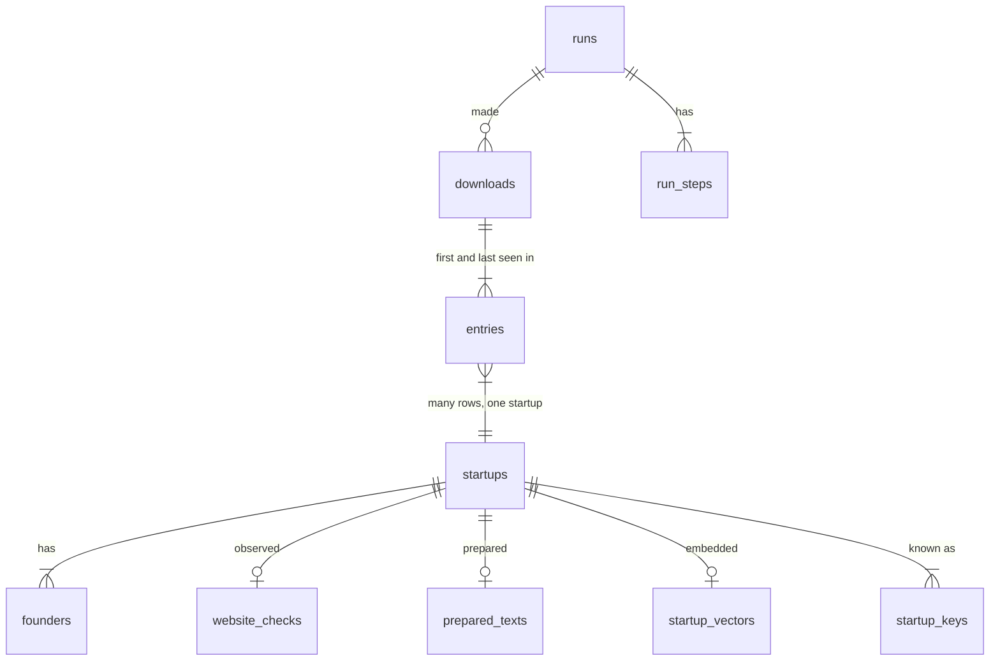

# Data

One SQLite file (`data/athar.db`) holds everything. Three kinds of table, kept apart:

- **As published**: what the registry said, never edited.
- **Derived by rule**: rebuilt from the published rows at any time; nobody decides anything by hand.
- **Observed or computed by Athar**: website answers, prepared text, vectors, idea checks.

## The source

The Startup Tunisia registry: one public GET, about 920 rows of JSON. It gives rows **no id** and returns them in a **different order on every request**, so a row's position means nothing. Fields: `name`, `desc`, `sector`, `industry`, `website`, `founders`, `label`, `creation_year`, `email`, `phone`, `logo`, `logo_id`.

## Steps

| Operation | Step | Writes | What it does |
|---|---|---|---|
| `collect` | collect | `downloads`, `entries` | Downloads the registry; stores each distinct row once, verbatim. The same rows in another order store nothing. |
| `collect`, `rebuild` | build | `startups`, `founders`, `startup_keys` | Reads every entry field by field and groups the rows of one company. |
| `check` | check | `website_checks` | Asks each website whether it answers, twice if it fails. About five minutes. |
| `prepare` | prepare | `prepared_texts`, `ai_usage` | Optional, needs an AI key. One plain English statement per description, used only for matching. |
| `embed` | embed | `startup_vectors`, `embedding_meta` | One vector per described startup, computed on this machine (Qwen3-Embedding-0.6B, 8-bit, 1024 dimensions). |

Every step writes counted facts to `run_steps.notes_json`. A run fails, with a plain message, only when the registry itself breaks: a used field disappears, a row has no name, or the row count drops by more than half.

## Tables

### As published

**`downloads`**: one row per download that published a different set of rows.
`id` (1, 2, 3), `url`, `fetched_at`, `last_checked_at` (moved by an identical download), `content_hash` (over the set of rows, not the bytes), `byte_size`, `row_count`, `run_id`.

**`entries`**: one row per distinct registry row.
`id` (first 12 hex characters of the SHA-256 of the row's content: same row, same id, in every download; an edited row is a new entry), `raw_json` (verbatim), `copies` (times the registry listed that exact row), `first_download`, `last_download`, `startup_id`.

### Derived by rule

**`startups`**: one row per real company.
`id` (a readable, permanent slug: `mon-ingenieur-express`), `entry_id` (the entry its values were read from), `name`, `description`, `language` (`en`, `fr`, `ar` or NULL), `sector`, `website`, `website_kind` (`own`, `hosted`, `social`, `shortlink` or NULL), `domain`, `labelled` (`YYYY-MM`), `creation_year`, `filled_json` (field to entry id, only when a second listing filled a gap), `notes_json` (plain facts as `[{code, text}]`), `first_download`, `last_download` (older than the newest download means the registry no longer publishes it; the startup is kept), `created_at`, `updated_at` (moves only when visible content changed).

**`founders`**: one row per founder per startup.
`startup_id`, `position`, `name` (as published), `person_key` (the name without case, accents or word order; the same key is the same person across startups).

**`startup_keys`**: every website (`site:…`) and name (`name:…`) a startup has been published under, so it keeps its id when one changes. Internal, never shown.

### Observed or computed

**`website_checks`**: the latest answer from each startup's own website. An observation with a date, never a verdict about the company.
`startup_id`, `url`, `status` (`reachable` or `unreachable`), `detail` (in words: `answered 200`, `no such domain`, `certificate problem`, `timed out`), `final_host` (when it answered from another domain), `checked_at`, `since`. No row means not asked: no website, or a page on a social network.

**`prepared_texts`**: `startup_id`, `input_hash`, `text`, `removed_json`, `key_id`, `model`. Used by Embed only; the registry description stays what the app cites.

**`startup_vectors`**, **`embedding_meta`**: one vector per startup that has a description, with the model, revision and text hash that produced it. A change in any of them re-embeds.

**`idea_checks`**: an idea someone typed and what the registry held about it at that moment.
`id`, `idea`, `language`, `checked_at`, `download`, `compared`, `matches_json` (`[{startupId, closeness, band}]` with band `close`, `far` or `nearest`), `explained_json` and `explained_model` (the AI's same and different sentences, when a key is saved), `saved`.

**`runs`**, **`run_steps`**: every operation and its steps, with `pid` (the process that owns the run) and `notes_json` (counted facts).

**`ai_keys`**, **`ai_usage`**: provider keys saved in the portal, and one row per AI call.

## How each registry field is read

One reader per field, in `src/server/pipeline/clean.ts`. Clean is a pure function: nothing it returns is stored per row, and Trace calls it again to show how a value was read.

| Field | Rule | Stored as |
|---|---|---|
| `name` | Kept as published, spaces tidied. Matching ignores case, accents, punctuation and a trailing legal form (SARL, S.A, Ltd). | `startups.name` |
| `desc` | Entities decoded, line breaks to spaces, language detected. | `startups.description`, `language` |
| `sector` | Kept. | `startups.sector` |
| `website` | The first address is kept; typing errors with one reading are repaired (`http::/x`, `htp://x`, `www..x`); any other text is dropped; the host is classified. | `startups.website`, `website_kind`, `domain` |
| `founders` | Names kept; blanks and repeats dropped; person key computed. | `founders` |
| `label` | `MM/YYYY` to a month. | `startups.labelled` |
| `creation_year` | Text to a number. | `startups.creation_year` |
| `industry`, `logo`, `logo_id` | Not read: identical to sector, one placeholder image, always empty. Collect checks on every download that this still holds. | only in `entries.raw_json` |
| `email`, `phone` | Not read. | only in `entries.raw_json` |

Two entries are one company when they share a website, or share a name, unless both have websites, the websites differ and no founder is common. On hosts many startups share (Facebook, Google Sites) the page path is part of the identity.

Two entries carry login details after the address in the website field. The stored entry keeps them verbatim; `displayRow` replaces them with `[extra text withheld]` before a raw row is shown, and the cleaned `startups.website` never holds them.

## Measured on 17 November 2026

921 rows, 918 entries, 901 startups, 1,975 founder rows, 1,915 people (56 on more than one startup). Languages: 793 English, 38 French, 70 none. Websites: 799 asked, 487 answer, 312 do not (222 domains no longer exist). 832 startups embedded; 69 have no description, 24 of them among the 28 labelled in 2025.

## Tests

`bun test` runs `src/server/pipeline/pipeline.test.ts`: the rules above, pinned to the cases found in the real registry.
